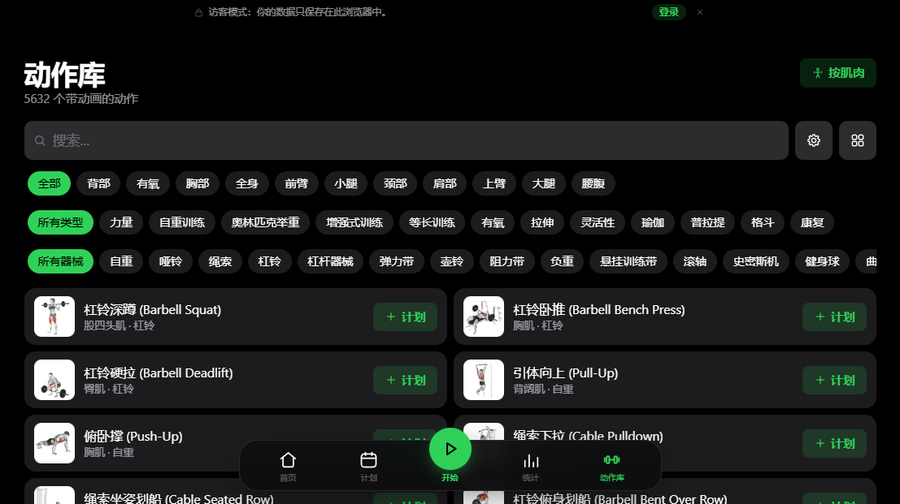
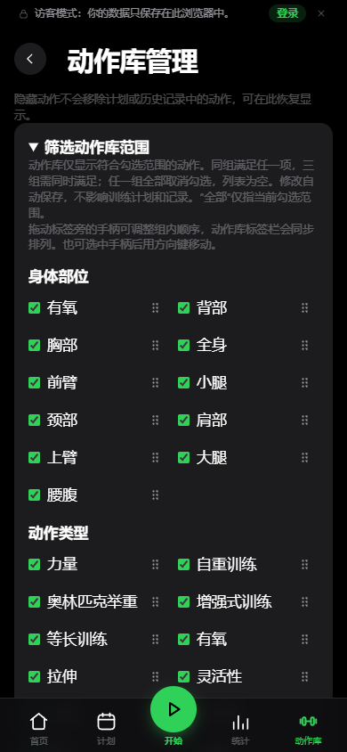
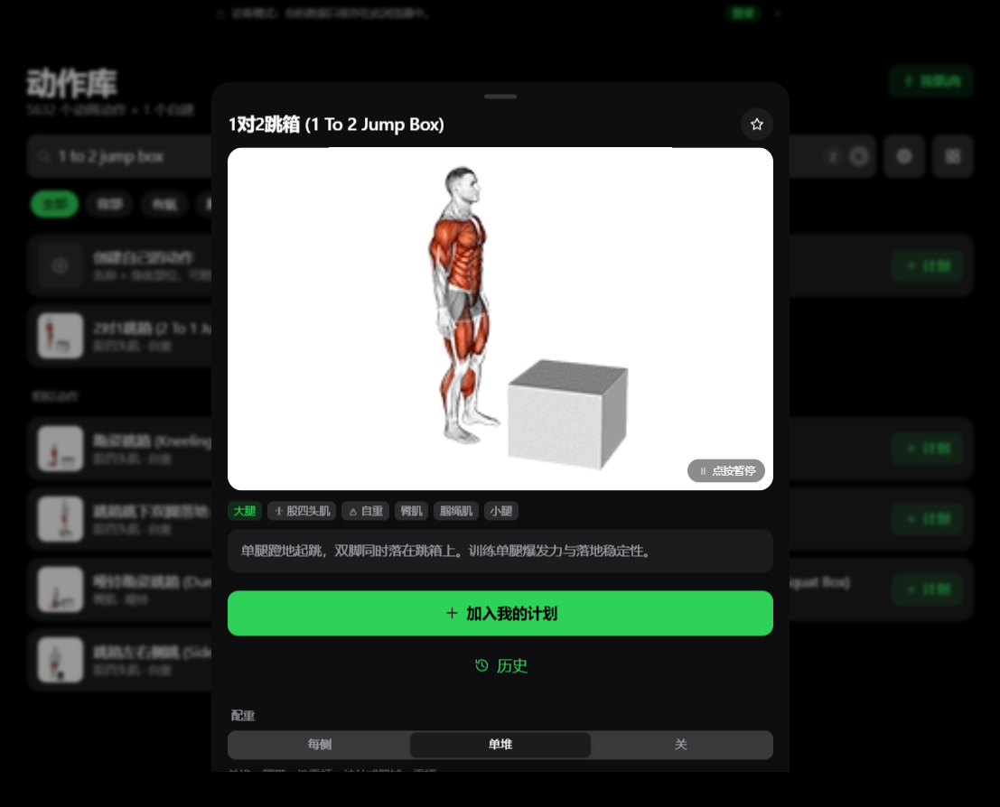

# myGym v1.0.0：相比 openGym 改了什么

myGym 是基于 [openGym](https://github.com/DuarteSantos8/openGym) 二次开发的个人健身应用。训练、计划和记录的基础能力延续原版；这一版重点让你更方便地整理动作库、阅读中文资料和查看训练信息。

**这次主要看三点：动作库自己整理 · 筛选偏好能保存 · 中文资料更完整**

## 01　动作库，按自己的习惯整理

**新增：内置动作的个人编辑与隐藏。**

- **内置动作也能改。** 原版可以创建自己的动作；现在还可以修改内置动作的名称、简介和训练要领，也能恢复原始内容。
- **不需要的动作，先隐藏。** 减少候选列表中的干扰，已有计划和历史记录中的动作引用会保留。
- **创建入口更集中。** 自建动作功能仍在，只是从动作库首行移到管理页。

*怎么找到：进入「动作库」，点击搜索框右侧的齿轮。图中部分基础动作优先展示，这是固定排序，并非按个人训练次数自动推荐。*

## 02　常用筛选，保存下来

**新增：筛选范围保存与标签排序。**

- **少选几次，沿用偏好。** 原版已有临时筛选；现在可保存身体部位、动作类型和器械范围，添加或替换动作时也能沿用。
- **常用标签放前面。** 拖动标签旁的手柄即可调整顺序，也支持触摸和方向键操作。

*怎么看：勾选决定动作范围，右侧手柄用来排列标签。三组条件共同生效；任意一组全部取消勾选，会让动作列表为空。*

## 03　看动作，多一份中文说明

**扩充：原有动作库的中文资料。**

- **补齐简介与训练要领。** 原版已有部分中文要领；现在为 5632 个内置动作补齐中文简介和要领，原有中文步骤继续保留。
- **文字随应用提供。** 打开动作即可查看本地资料，不需要现场调用翻译服务。

*看哪里：演示图下方是该动作的中文简介。动作演示素材沿用原项目；新增文字包含机器翻译，个别术语仍待校对。*

## 还有两处日常变化

| 原版展示或操作 | myGym 的变化 |
| --- | --- |
| 首页和统计摘要显示连续周数 | 改为累计训练时长，只计算已保存且有有效起止时间的训练 |
| 原有动作进度卡片位置较靠后 | 移到更靠前的位置，图表和训练公式没有因此改变 |
| 查看进度照片时操作入口较少 | 查看器增加删除和替换入口，替换时保留对应训练与其他附件 |

## 使用前，知道这些取舍

- **器械管理入口减少了。** 移除了器械场景、杠铃片和哑铃库存的管理界面。旧配置仍可能影响动作筛选和重量选择，依赖这些设置的用户需留意。
- **Android 改为手动更新。** 关闭原版应用内更新，后续手动获取新版正式 APK，再覆盖安装。首次从测试版切换正式版，请先备份、再导入数据。
- **还有需要完善的地方。** 中文术语、正式版迁移和覆盖升级仍需继续校对或验证；不代表所有设备和升级场景都已验收。

---

训练记录、计划、备份、同步及多数统计能力来自原版。myGym 在这些基础上增加个人整理工具，并调整部分展示与流程。后续将继续校对中文资料、验证迁移与手动升级，并完善旧配置维护方式。

感谢 [DuarteSantos8/openGym](https://github.com/DuarteSantos8/openGym) 的作者与贡献者。代码与第三方媒体的许可范围不同，见 [LICENSE](LICENSE)、[NOTICE.md](NOTICE.md)。

> 配图为已有回归检查中的实际界面，使用演示数据；截图时间与界面状态可能不同。对比范围为 openGym 1.4.1 与 myGym v1.0.0。具体代码依据、修复记录与限制见[详细改动说明](MYGYM_CHANGELOG_DETAILED.md)。
